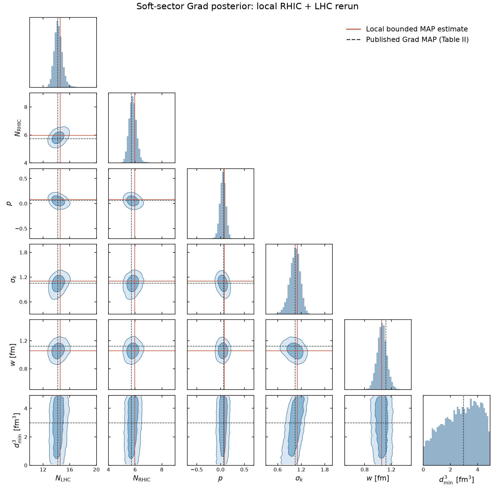
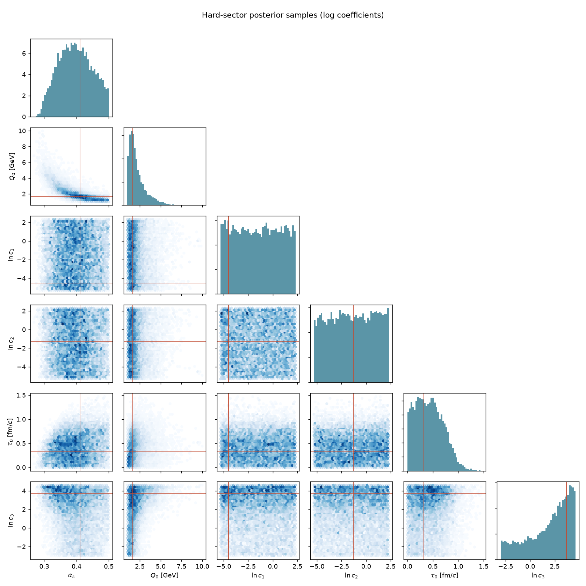

# JETSCAPE resources

> **Personal resource collection.** I am a member of the JETSCAPE Collaboration, but this repository is maintained in my personal capacity for convenient use of JETSCAPE. It is not an official collaboration documentation project or release and does not represent collaboration endorsement. The original studies, software and datasets retain their authorship and attribution; please cite their original sources.

> **Use and validation.** These materials are provided “as is” for reference and convenience, without warranty of accuracy, completeness or fitness for a particular purpose. Users are responsible for independently checking the software, inputs and analysis choices, and for validating results before scientific use.

Practical examples for installing JETSCAPE, generating soft-only or hard-focused events, reading hadron lists, and exploring earlier Bayesian inference studies. The examples cover Au–Au at 200 GeV and Pb–Pb at 2.76 and 5.02 TeV, using a pinned JETSCAPE 3.7.1 software stack. The inference notebooks read existing results; they do not launch a calibration campaign.

## Choose a starting point

| What you want to do | Start here | What is included |
| --- | --- | --- |
| Install JETSCAPE | [Installation guide](installation.md) | Source revisions, required dependencies, table retrieval and build scripts |
| Generate events | [Simulation guide](simulations.md) · [Example settings](examples/README.md) | Soft-only and hard-focused XMLs, auxiliary inputs and a Slurm example |
| Read output | [Hadron format](hadron-format.md) | A seven-column ASCII reader, sample particle lists and a plotting script |
| Explore the soft-sector study | [Soft-sector guide](soft/README.md) · [Notebook](soft/soft_sector.ipynb) | Posterior corner plots, local/published MAP comparison, public designs and reference inputs |
| Explore the hard-sector study | [Hard-sector guide](hard/README.md) · [Notebook](hard/hard_sector.ipynb) | Six-parameter MCMC samples, posterior plots, joint-mode estimation and coefficient conversion |

The main folders are `examples/`, `soft/`, `hard/`, `scripts/`, `figures/` and `tests/`. Each study's notebook and input metadata sit together in its top-level folder. Soft-study datasets and emulators remain in the public [SIMS repository](https://github.com/j-f-paquet/js-sims-bayes); the downloader retrieves a small pinned selection. The soft full-data posterior and compressed hard posterior archive are included here.

## What each part provides

### Installation and standalone event generation

[installation.md](installation.md) explains the pinned JETSCAPE 3.7.1 stack, dependencies, LBT tables and installation into a fresh directory. The helpers preview their commands before execution and retain source identities and build logs. Choose the build that fits the calculation:

| Profile | Modules | Appropriate example |
| --- | --- | --- |
| `legacy-soft` | TRENTo, free streaming, MUSIC, iSS and SMASH | Soft hadrons and their hadronic transport |
| `hard-focused` | TRENTo, free streaming, MUSIC, Pythia, MATTER, LBT and jet hadronization | Hard hadrons in a generated medium; iSS and SMASH disabled |

**Hard-focused runs can use either installation profile.** A full installation may include iSS and SMASH; omitting their XML blocks keeps them inactive. The optional hard profile avoids installing these components when they are not needed. MUSIC and free streaming are still needed to provide the medium in this example. The profile is checked against the pinned CMake switches; a complete native build of this new profile has not been run here.

[simulations.md](simulations.md) takes an installed executable through a seeded run in a fresh directory, with an optional container and Slurm entry point. [examples/](examples/README.md) contains the user XMLs, framework defaults and auxiliary inputs. The examples use the published **Grad soft MAP** for the calibrated energies and the documented normalization extension at 5.02 TeV; the hard XMLs add the sample-based hard joint KDE reference. The soft notebook’s later local MAP estimate is kept separate from the simulation tune.

### Output format and simple inspection

[hadron-format.md](hadron-format.md) explains event boundaries, the seven particle columns, units, status codes, weights and the hard cross-section footer. The inspection helper checks file structure and finite values. The plotting helper makes a basic momentum diagnostic with an explicit particle/status selection. These are useful first checks before adopting a versioned JETSCAPE-analysis workflow for experimental observables.

The bundled [particle samples](examples/sample_metadata.json) illustrate the output format, soft hypersurface oversampling and hard hydro reuse. Builds and small execution checks establish software behavior; validating a spectrum requires an appropriate event ensemble and observable definition.

### Soft-sector Bayesian results

[soft/](soft/README.md) accompanies the completed combined RHIC/LHC calibration, PRC **103**, 054904. Its notebook reads a small pinned selection of upstream designs/model outputs and the included local full-data Grad posterior. It produces the full 18-parameter and selected corner plots and an 18-row comparison between the locally optimized joint MAP and the paper’s Table II. The local likelihood and prior differences are explicit. Published MAP values, rounded code-side references and the local reconstruction are separately named.

### Hard-sector Bayesian results

[hard/](hard/README.md) accompanies the inclusive jet/hadron suppression calibration, PRC **111**, 054913. Its notebook reads the included 250,000-by-6 sample archive, draws posterior correlations, summarizes the samples and demonstrates joint KDE mode estimation. It converts the logarithmic coefficient coordinates into physical XML inputs once. The hard reference point is estimated from the supplied posterior samples with a joint KDE; it is not a MAP vector quoted from a published table. The hard guide explains the estimator and dataset scope.

## Explore the inference resources

From the repository root, create a plotting environment and fetch the public soft inputs:

```bash
python3 -m venv .venv
source .venv/bin/activate
python -m pip install -r requirements-inference.txt
python scripts/fetch_soft_inputs.py
```

Open [soft/soft_sector.ipynb](soft/soft_sector.ipynb) or [hard/hard_sector.ipynb](hard/hard_sector.ipynb) using this environment. To run both without a notebook interface:

```bash
python scripts/check_inference_notebooks.py
```

Generated figures, tables and executed notebook copies go to `outputs/`; downloaded inputs go to `.cache/`. Both directories are ignored by Git. The soft notebook runs its posterior corner plots and MAP comparison from the included 18-parameter full-data Grad rerun. Its public design/reference examples also use the downloaded inputs.

### Soft-sector posterior and MAP comparison



Selected marginals from the included local full-data Grad posterior. The [soft notebook](soft/soft_sector.ipynb) also produces the full 18-parameter corner plot and compares a bounded joint MAP estimate with [Table II of the study](https://arxiv.org/html/2011.01430v2#S7.T2). MAP estimates depend on practical likelihood, prior and optimization details. The local result is an illustration; use the published values for the reference simulation tune. Details are in the [soft guide](soft/README.md).

### Hard-sector posterior correlations



Marginals and correlations from the [included sample archive](hard/MCMCSamples.txt.bz2). The three coefficient axes are $\ln c_i$; red lines mark the supplied approximate joint KDE reference point. The plot uses a seeded 20,000-row subset, while numerical summaries use all 250,000 rows. The reference point is estimated from these samples for this walkthrough; it is not quoted from a MAP table in the [related hard-sector paper](https://arxiv.org/abs/2408.08247). Dataset scope is described in the hard guide. The [hard notebook](hard/hard_sector.ipynb) regenerates the plot and explains the reference-point calculation.

## Try the particle reader

No JETSCAPE installation is needed to inspect the included particle samples:

```bash
python3 scripts/inspect_hadrons.py examples/soft_hadrons.dat \
  --expected-events 1 --require-particles
python3 scripts/inspect_hadrons.py examples/hard_hadrons.dat \
  --expected-events 3 --require-particles
```

The samples demonstrate file structure and particle-status handling; they are not statistical tests of a physics tune. For a diagnostic $p_T$ plot, install `requirements-plot.txt` and use `scripts/plot_hadrons.py`. The [hadron guide](hadron-format.md) explains weights, cross-section footers and event grouping.

## Generate a small event sample

After following the [installation guide](installation.md), preview a run with an existing installation:

```bash
python3 scripts/run_simulation.py \
  --source /path/to/JETSCAPE \
  --config examples/soft_AuAu200.xml \
  --run-dir /path/to/new-soft-run \
  --events 1 --seed 261025101
```

Add `--execute` to generate the soft example. For the hard example, select `examples/hard_AuAu200.xml`, use a new run directory and set `--events 3` to demonstrate three hard events sharing one hydro background. The soft example uses TRENTo, free streaming, MUSIC, iSS and SMASH, with three hypersurface samples per framework event. The hard example uses a medium from TRENTo, free streaming and MUSIC, with Pythia, MATTER, LBT and colorless hadronization. Run builds and simulations on allocated compute nodes when using a shared cluster; `examples/run_slurm.sbatch` supplies a scheduler entry point.

The XMLs are standalone examples, not exact reproductions of either calibration's simulation ensemble. Parameter units, $d_{\min}^3$ versus $d_{\min}$, and $\ln c_i$ versus $c_i$ are documented in the [settings guide](examples/README.md). A continuous MAP, a KDE mode and the highest-posterior retained sample are different estimates; the notebooks preserve their coordinate and method declarations.

## Version choice

The supplied examples remain pinned to 3.7.1 for a documented software baseline. JETSCAPE has since released 3.7.2 and the 4.0 series, with physics/runtime fixes, parallel sampling/surface-finding work and dependency/build changes. See the [release comparison](versions.md) before changing a study’s software version.

## References and software

**Framework and calibration papers**

- JETSCAPE Collaboration, *The JETSCAPE framework*, [arXiv:1903.07706](https://arxiv.org/abs/1903.07706). [JETSCAPE source and documentation](https://github.com/JETSCAPE/JETSCAPE).
- D. Everett et al. (JETSCAPE), *Multisystem Bayesian constraints on the transport coefficients of QCD matter*, Phys. Rev. C **103**, 054904 (2021). [Paper](https://arxiv.org/abs/2011.01430) · [SIMS code and data](https://github.com/j-f-paquet/js-sims-bayes).
- R. Ehlers et al. (JETSCAPE), *Bayesian Inference analysis of jet quenching using inclusive jet and hadron suppression measurements*, Phys. Rev. C **111**, 054913 (2025). [Paper](https://arxiv.org/abs/2408.08247).

**Related completed simulations and analysis**

The companion repository [radial-flow-resources](https://github.com/LipeiDu/radial-flow-resources) contains the published soft-event configurations and saved-result notebooks for these two studies:

- L. Du, *Characterizing radial flow fluctuations in relativistic heavy-ion collisions at top RHIC and LHC energies*, Phys. Rev. C **113**, 014901 (2026). [Paper](https://arxiv.org/abs/2508.07184) · [Related simulation resources](https://github.com/LipeiDu/radial-flow-resources).

- L. Du, *Kinematic and dynamical origins of mean-$p_T$ fluctuations in heavy-ion collisions*, Phys. Lett. B **874**, 140225 (2026). [Paper](https://arxiv.org/abs/2512.22715).

The soft calibration supplies the published medium reference; the hard calibration supplies the posterior used for the reconstructed hard point. The radial-flow papers demonstrate the related soft-event workflow. This collection supplies reusable examples and readers; each paper’s production and analysis settings must be matched when reproducing its results.

Component repositories and immutable revisions are listed in [examples/software_versions.json](examples/software_versions.json). The helper code uses GPLv3-or-later; upstream code and data retain their own attribution and terms in [THIRD_PARTY_NOTICES.md](THIRD_PARTY_NOTICES.md). Cite the relevant study and software when reusing their results. AI assistance was used to prepare documentation and adapt the reader notebooks and helpers; the original research and data are credited to their respective sources.

## Checks

The installation and particle-I/O tests use the Python standard library:

```bash
python3 -m unittest discover -s tests -v
```

After installing the inference requirements, run the numerical-reader and coordinate checks and execute the public notebooks:

```bash
python -m unittest discover -s tests/inference -v
python scripts/fetch_soft_inputs.py
python scripts/check_inference_notebooks.py
python scripts/check_links.py
```

Use `python scripts/check_links.py --external` to check the outward links anonymously. These checks cover the supplied readers and workflows; they do not establish calibration convergence, emulator accuracy or statistical agreement with experimental data.
