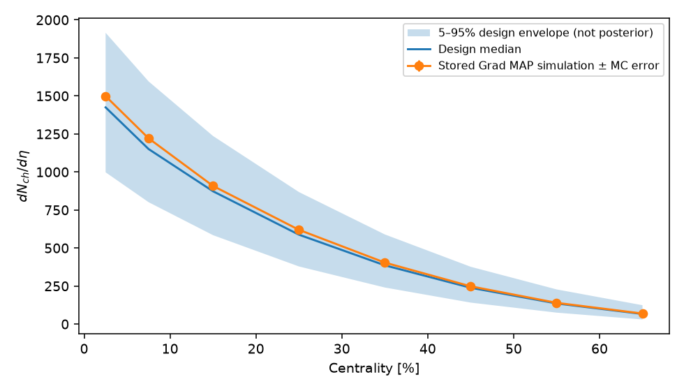

# Soft-sector Bayesian inference resources

This walkthrough uses the public [j-f-paquet/js-sims-bayes repository](https://github.com/j-f-paquet/js-sims-bayes) accompanying the JETSCAPE study [*Multisystem Bayesian constraints on the transport coefficients of QCD matter*](https://arxiv.org/abs/2011.01430), Phys. Rev. C 103, 054904 (2021). The original study, code and simulated results are credited to that collaboration and repository.

## Run the walkthrough

Follow the [environment setup](../README.md#explore-the-inference-resources), then open [soft_sector.ipynb](soft_sector.ipynb). It inspects the public design/reference inputs, plots the included full-data Grad posterior, and compares a joint MAP estimate with the paper’s Table II.

```bash
python scripts/fetch_soft_inputs.py
```

The [download manifest](upstream_manifest.json) identifies four files by URL, byte size and SHA-256 at commit `9c8ffc63cc0f79ddb34d1d91c208b0e4cac9d39e`. The approximately 5.7 MiB download stays in ignored `.cache/soft-sector/`; source datasets and serialized emulators are not mirrored here. To use identical files already held locally, pass `--from-source /path/to/matching/source`. `SOFT_CACHE` can select another verified cache for the notebook.

## Files and interpretation

| File | Purpose |
| --- | --- |
| [soft_sector.ipynb](soft_sector.ipynb) | Reference inputs, posterior corner plots and MAP comparison |
| [reference_points.json](reference_points.json) | Active code-side Grad, CE and PTB reference vectors from the pinned source |
| [observable_schema.json](observable_schema.json) | Observable order, centrality bins, binary layout and explicit Grad design exclusions |
| [upstream_manifest.json](upstream_manifest.json) | Versioned public input locations and checksums |
| [posterior.npz](posterior.npz) · [metadata](posterior_metadata.json) | 9,127 weighted 18-parameter samples from a local full-data Grad rerun |
| [published_map.json](published_map.json) | Exact printed Grad/CE/PTB values from Table II |
| [map_result.json](map_result.json) · [comparison CSV](map_comparison.csv) | Bounded joint MAP estimate and the published-value comparison |

The reference vectors have 17 coordinates per collision system, with the original upstream rounding. A joint two-system posterior instead has two normalizations and can have an additional model-discrepancy parameter. Preserve the full declared parameter order; an 18-dimensional target and a 19-dimensional target are different distributions. The design coordinate `dmin3` represents $d_{\min}^3$ in fm$^3$; the older label file's length label must not be used as an XML conversion rule.

The stored observable files contain four delta-$f$ slots with little-endian float64 mean/error pairs. Only the Grad slot is populated in the MAP files. The Pb MAP file includes a zero-filled Au block after its Pb block; the Au MAP file is a separate nonzero Au record. The reader checks the full layout and does not discard trailing bytes. The design envelope is not a posterior uncertainty band, and this example does not perform an experimental-data or likelihood fit.



Pb–Pb 2.76 TeV charged multiplicity: the shaded region is the 5–95% design envelope after the explicit Grad exclusions; points show the stored reference simulation with its reported Monte Carlo errors. The notebook regenerates this illustration from the pinned public inputs.

## Posterior corner plots and MAP

The included posterior is a local full-data Grad rerun for combined Pb–Pb 2.76 TeV and Au–Au 200 GeV data, using the completed study’s code and saved emulators. It has two system normalizations and 16 shared coordinates; `sigma_M` is excluded, consistent with [Section V.4](https://arxiv.org/html/2011.01430v2#S5.SS4). All 9,127 rows retain their importance weights. No additional burn-in, thinning or sample cuts are applied. The notebook saves the full 18-parameter corner plot and the selected-parameter view below.


Blue contours enclose 68% and 95% of the smoothed weighted two-dimensional histogram mass. Red lines show the local bounded MAP estimate; dark dashed lines show the paper’s Grad MAP. The [full corner plot](../figures/soft_corner_full.png) includes every coordinate.

**Use the published MAP values for reference simulations.** MAP estimates depend on practical details of the likelihood, priors, emulator and optimization. The local values here illustrate the workflow and should not replace the published tune.

The [published values](published_map.json) were transcribed from [Table II](https://arxiv.org/html/2011.01430v2#S7.T2), preserving its printed precision. They are separate from the older rounded code-side reference table used above. The local MAP is obtained by maximizing the matching emulator likelihood, including its parameter-dependent covariance, from three starts: the highest-posterior retained sample, the published Grad point and the weighted posterior mean. All three optimizations converged; the highest posterior value is retained. This is a joint bounded MAP estimate, with global optimality unestablished.

| Parameter | Published Grad MAP | Local MAP estimate |
| --- | ---: | ---: |
| `norm_PbPb2760` | 14.2 | 14.5802 |
| `norm_AuAu200` | 5.73 | 5.96447 |
| `trento_p` | 0.063 | 0.0812941 |
| `sigma_k` | 1.05 | 1.1027 |
| `nucleon_width [fm]` | 1.12 | 1.05483 |
| `dmin3 [fm^3]` | 2.97 | 4.913 |
| `tau_R [fm/c]` | 1.46 | 1.50677 |
| `alpha` | 0.031 | 0.140574 |
| `eta_over_s_T_kink_in_GeV [GeV]` | 0.223 | 0.223332 |
| `eta_over_s_low_T_slope_in_GeV [GeV^-1]` | -0.776 | -1.18497 |
| `eta_over_s_high_T_slope_in_GeV [GeV^-1]` | 0.37 | -0.887878 |
| `eta_over_s_at_kink` | 0.096 | 0.0784304 |
| `zeta_over_s_max` | 0.133 | 0.124544 |
| `zeta_over_s_T_peak_in_GeV [GeV]` | 0.12 | 0.148668 |
| `zeta_over_s_width_in_GeV [GeV]` | 0.072 | 0.0577502 |
| `zeta_over_s_lambda_asymm` | -0.122 | 0.648296 |
| `shear_relax_time_factor` | 4.65 | 3.54081 |
| `Tswitch [GeV]` | 0.136 | 0.137554 |

The comparison uses the declared local 146-bin likelihood. Three local prior ranges differ from the paper’s Table I: Au–Au normalization `[4,9]` versus `[3,10]`, maximum bulk viscosity `[0.01,0.20]` versus `[0.01,0.25]`, and switching temperature `[0.130,0.165]` versus `[0.135,0.165]` GeV. The local minimum-distance cube reaches its upper bound. These differences and the likelihood inventory prevent interpreting the result as an exact recovery of the paper’s MAP. The sample archive and its metadata preserve the local target.

The notebook reproduces the plots and comparison with `requirements-inference.txt`. To recompute the optimization, use the compatible Python environment for the matching SIMS source and emulators:

```bash
python scripts/find_soft_map.py --sims-source /path/to/matching/js-sims-bayes \
  --posterior soft/posterior.npz --published soft/published_map.json \
  --output outputs/inference/soft_map_recomputed.json
```

The optimizer checks the parameter box and saved likelihood scores before running. Posterior plotting and reading the saved MAP table require no serialized emulator loading. Marginal medians, highest-posterior retained samples, KDE modes and optimized MAP estimates remain distinct quantities.

## Upstream model inputs

The public source provides [designs](https://github.com/j-f-paquet/js-sims-bayes/tree/9c8ffc63cc0f79ddb34d1d91c208b0e4cac9d39e/production_designs), [simulated observables](https://github.com/j-f-paquet/js-sims-bayes/tree/9c8ffc63cc0f79ddb34d1d91c208b0e4cac9d39e/model_calculations), [saved emulators](https://github.com/j-f-paquet/js-sims-bayes/tree/9c8ffc63cc0f79ddb34d1d91c208b0e4cac9d39e/emulator), and a [legacy environment](https://github.com/j-f-paquet/js-sims-bayes/blob/9c8ffc63cc0f79ddb34d1d91c208b0e4cac9d39e/environment.yml). Loading serialized models requires the matching source and dependency environment.

## Simulation input conventions

For the calibrated collision energies, the example XMLs use the published Grad values, not the locally re-estimated MAP above. The 5.02 TeV example uses the normalization extension documented in the [example settings](../examples/README.md). The paper defines a fluctuation standard deviation `sigma_k`; the pinned TRENTo input is gamma shape `k=1/sigma_k^2`. The minimum-distance input is a length, obtained from `dmin3^(1/3)`. The [input mappings](../examples/parameter_audit.json) state the convention used here.
